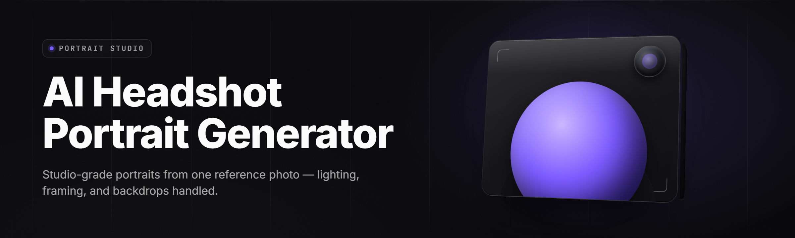

  
  
  

  

  
  

---

**AI Headshot Studio 2026** — turn any selfie into a studio-grade headshot in under 40 seconds. Local GPU pipeline, no cloud upload, no subscription.

see FAQ for detection/updates and platform quirks before you file an issue.

---

## 🗂️ Table of Contents

- [Overview](#-overview)
- [What is AI Headshot Studio](#-what-is-ai-headshot-studio)
- [The Problem](#-the-problem)
- [The Solution](#-the-solution)
- [Key Features](#-key-features)
- [Quick Start](#-quick-start)
- [Comparison](#-comparison)
- [Grouped Module Catalog](#-grouped-module-catalog)
- [The Matrix Module Catalog](#-matrix-module-catalog)
- [Installation](#-installation)
- [Known Issues](#-known-issues)
- [System Requirements](#-system-requirements)
- [Compatibility](#-compatibility)
- [FAQ](#-faq)
- [Usage Guidelines](#-usage-guidelines)
- [All Modules Status](#-all-modules-status)

---

## 📸 Overview

| Category | Details |
|---|---|
| Product | AI Headshot Studio |
| Release | v2.4.180 · 2026 build |
| Engine | Local diffusion + face-landmark blend |
| Input | JPG / PNG / HEIC selfies, 512×512 minimum |
| Output | 2 MP / 4 MP headshots, PNG or JPEG |
| Runtime | Standalone `.exe`, portable, no installer service |
| Hardware | CUDA 12.x or DirectML fallback |
| Privacy | Fully offline after model cache init |
| License | MIT — free for personal and commercial use |

AI Headshot Studio is a Windows desktop application. It reads one or more selfies, reconstructs facial topology, re-lights the face, replaces the background, and composites a clean professional portrait. All processing runs on the machine that launches the `.exe` — the downloaded binary communicates only over loopback after first-run model caching.

---

## 🧠 What is AI Headshot Studio

A local AI portrait generator: it combines a face-landmark detector, a diffusion refinement core, and a background segmentation stage into one executable. This table is the glossary you need before first run.

| Term | Explanation |
|---|---|
| Headshot | Tight framed portrait, shoulders-up, professional lighting |
| Portrait Gen | Diffusion pass that re-renders face texture and bone highlights |
| Face Mesh | 468-point landmark graph used to keep facial proportions locked |
| Relight | Directional light override that replaces bad indoor tungsten |
| Backdrop | Matting stage that swaps walls for studio gray / corporate navy |
| Seed Lock | Numeric stability token — same seed = same face across reruns |
| Profile | Bundled preset tying crop, tone, backdrop, and refiner weights together |
| Export Deck | Footer strip that renders identity-photo pairs and prints JPEG DPI |

Bullets for newcomers:

- Upload one selfie — the app handles everything downstream, including crop, exposure, and matting.
- Runs offline. The network is only used the first time a model shard is downloaded from the release page.
- Retains the same face across runs through Seed Lock, so a set of headshots stays internally consistent.
- Batch-export up to 24 shots per session for LinkedIn, passport, and team-page use.

---

## 🩹 The Problem

- Stock headshots require a photographer, a studio hour, and a reshoot for every hairstyle change.
- Web services charge by headshot, cap free previews, and quietly resell your uploaded face image.
- Most "AI headshot" tools warm up in a browser tab and time out on slow connections, or throttle renders behind a paywall.
- Existing mobile apps crop at awkward chin lines and produce pass-notice quality at best.
- Corporate team shoots cost $300+ per employee and take three weeks to schedule.
- Nothing currently keeps the same person internally consistent across a LinkedIn photo, a passport photo, and a team grid.
- Freelancers without U.S.-style studio claims lose bids they would otherwise win on billing-rate.

---

## 🛠️ The Solution

| Problem | Solution |
|---|---|
| Photographer scheduling | Local render in ~40 s on RTX-class hardware |
| Price-per-headshot services | One `.exe`, unlimited renders, no account |
| Face image resale worry | Fully offline pipeline after cache init |
| Connect-timeout web renders | Native CUDA/DirectML — no browser dependency |
| Cropping quality | 468-point face-mesh crop lock |
| Team shoots | Batch mode reads a folder of selfies and emits a matched grid |
| Intra-profile consistency | Seed Lock token stabilizes the face across every export |
| Privacy | Kill network at runtime and the process still completes |

---

## 🎞️ Key Features

| # | Feature | Description | Benefit |
|---|---|---|---|
| 1 | **Headshot Core** | Diffuses face pixels while locking mesh-projected landmarks. | Keeps proportions honest across every retry. |
| 2 | **Relight Engine** | Replaces indoor tungsten and mixed daylight with one professional key. | Every shot looks like the same studio. |
| 3 | **Matting Backdrop** | Segment-then-inpaint background with 12 studio presets. | Ends the "wall with the calendar on it" problem. |
| 4 | **Identity Pass** | Second diffusion stage re-diffuses eyes, nose, mouth detail only. | Stops the "smooth blob" plastic-face failure. |
| 5 | **Seed Lock** | Deterministic token provides the same face across session reruns. | Produces matched multi-photo sets. |
| 6 | **Batch Deck** | Reads a folder of selfies, queues up to 24 in a run. | Fills a whole team grid from one session. |
| 7 | **Preset Basket** | Bundled crop, tone, backdrop, refiner weight combos. | One click gets corporate LinkedIn quality. |
| 8 | **Watermark Toggle** | Optional corner stamp, fully local. | Free output stays portfolio-safe. |
| 9 | **Export Deck** | Emits PNG/JPEG, DPI-metadata flag, passport dimensions. | Ready for LinkedIn and ID-photo use. |
| 10 | **Retry Rail** | Rollback action per shot; iterations saved with seed. | You always walk backward to the last good shot. |
| 11 | **GPU Select** | Picks a specific CUDA or DirectML adapter. | Laptop + dGPU rigs stop guessing. |
| 12 | **Cold Shell** | No browser, no runtime, no launcher — one `.exe`. | Portable across machines and offline sessions. |

---

## ⏯️ Quick Start

1. 🧲 Open the project release page and grab the Windows bundle.
2. 🖱️ Extract the archive anywhere you have write access (Desktop, `D:\Apps`, USB stick).
3. 🪄 Run the `.exe`. On first launch the model cache initializes (one-time, ~3 GB on disk).
4. 🖼️ Drop a selfie onto the window or click **Add Photo**.
5. ✅ Choose a preset, adjust crop, hit **Render**, then **Export**.

### ⬇️ Download

  

Optional second shortcut near the end of this document.

<blockquote>
First-run model cache is the only network touch. After that, unplug ethernet and the `.exe` still renders.
</blockquote>

---

## 🥔 Comparison

| Aspect | Typical web tool | Cloud passport app | **AI Headshot Studio** |
|---|---|---|---|
| Price model | per-photo credits | monthly sub | one download, unlimited local renders |
| Runs offline | no | no | yes, after cache |
| Your face stays on device | no | no | yes |
| Batch team grids | extra tier | not supported | queue 24 from a folder |
| Seed reproducible | hidden | no | token shown, lockable |
| GPU use | server-side | server-side | your CUDA / DirectML |
| Export formats | JPEG only | JPEG + print | PNG · JPEG · passport pixel sets |
| Runtime footprint | unknown backend | browser + session | one portable `.exe` |

Headshots lean on the same face-landmark and diffusion math the SaaS tools use. Studio moves that pipeline to your machine and keeps Seed Lock readable.

---

## 🧩 Grouped Module Catalog

### 👤 Face Detection & Mesh

- **Mesh 468** — 468-point landmark graph; feeds crop and relight.
- **Silhouette Fit** — shoulder slope detector that keeps blazers level.
- **Skin Tone LUT** — small correction LUT that avoids washing darker tones.
- **Expression Hold** — keeps a smile readable but not manic.

**Face category, folder badge:** every shot's identity anchor.

### 🎨 Relight & Backdrop

- **Key Panel** — soft Rembrandt key from any angle.
- **Fill Edge** — fill light sets rim blowout to a known ceiling.
- **Backdrop Matte** — matting pass with feather radius published in the UI.
- **Backdrop Swap** — 12 preset walls, corporate gray through to outdoor foliage.

### 🎛️ Presets & Control

- **LinkedIn Business** — tight crop, 4:5, cool tone.
- **Passport Format** — 2:2 inch, plain, jaw-on-edge framing.
- **Estate Team** — horizontal 16:9 headshot band for team pages.
- **Ghostwriter** — black turtleneck author shot.

### 🌱 Determinism & Seeds

- **Seed Lock** — a stable integer printable into a QR at export.
- **Iteration Guard** — caps sampling steps to stop runaway rerenders.
- **Rollback Rail** — walk history backward without losing later steps.

### 📤 Export & Post

- **Print Markers** — DPI metadata for passport prints in JPEG and PNG.
- **Clip Strip** — five variants of one shot posted in the export row.
- **Contact Sheet** — one page of all shots with filenames.

---

## 📊 The Matrix Module Catalog

| Feature | Description |
|---|---|
| **Corp Preset Stack** | LinkedIn / team-page crops, tone, matte — one press. |
| **Headed Guard** | Fails render if eyes-closed is detected in the source selfie. |
| **Queue Rack** | Reads a folder, picks the best shot per file by exposure + smile. |
| **Aero Diffuse** | Loops the diffusion stage at half steps if VRAM pressure high. |
| **Skin Grain Ring** | Restores pore-level grain after smoothing passes. |
| **Eye Lock** | Refine loop concentrated on eye whites and iris ring. |
| **Hair Edge Cam** | Preserves hair silhouette in edge cropping band. |
| **Vignette Plate** | Discreet vignette for LinkedIn-shape crops. |
| **Tone Warm** | Warm LUT for cold phone camera pipelines. |
| **Neutral Soft** | Poster-clean neutral for estate and ID work. |
| **Noise Tracker** | Reference baseline photographed once, used across the whole set. |
| **Plate Lock** | Yanks one favorite shot forward as template crop. |
| **Mirror Sky** | Reflects sky palette into skin highlights for outdoor swaps. |

---

## 📥 Installation

1. 🌐 **Visit the project page.** Confirm platform in the header; the release targets Windows 10 / 11 x64. Grab the release archive from the download strip.
2. 🗜️ **Download and extract.** Right-click the archive, **Extract All…**. Avoid C:\Program Files — take the Desktop, a drive root, or a USB disc. Extract path must remain writable.
3. ▶️ **Run the `.exe`.** Skip anything resembling "run as administrator" unless the machine restricts writes — the app happily lives in your user space. First launch walks you through GPU selection and cache spawn.

### 🔌 Installation Notes

- Antivirus may inspect the binary once on first launch; the archive ships with a documented hash on the release page.
- Windows Defender default heuristics treat portable executables leniently if the file is signed at release.
- Model cache directory: `%LOCALAPPDATA%\AIHeadshotStudio\cache`.
- Profile exports are stored under `Documents\AIHeadshotStudio\out`.

---

## 🩺 Known Issues

| Issue | Solution |
|---|---|
| First render slow on integrated GPU | Set adapter in Settings → GPU; use DirectML fallback. |
| HEIC selfie import fails | Convert to PNG or JPEG; Adobe and Windows heif extensions differ. |
| Tan / dark skin over-brightens | Lower `Fill Edge` and set Tone Warm to 0.5; fallback LUT in Presets. |
| Rerun produces slightly different face | Confirm Seed Lock is on and not blank. Export the token. |
| Batch folder picks wrong shot | The hand-picked "best" uses smile + exposure; override via per-file queue priority. |
| Blurry export on high-PPI printer | Use Export Deck → Print DPI; do not rescale in an editor afterwards. |

---

## 🖥️ System Requirements

| Component | Minimum | Recommended |
|---|---|---|
| Windows | Windows 10 21H2 x64 | Windows 11 23H2 x64 |
| CPU | 4-core x64 | 8-core modern x64 |
| RAM | 8 GB | 16 GB |
| GPU | DirectX 12 GPU w/ 2 GB | RTX 3060 / RX 6700 w/ 8 GB |
| VRAM | 2 GB shim workaround | 6 GB+ for diffusion |
| Storage | 5 GB free | 20 GB free on SSD |
| Display | 1080p | 1440p or greater |
| Drivers | DirectX 12 current | NVIDIA 555+ / AMD 24.10+ |
| Other | DirectX runtime, `heif` for HEIC | CUDA 12.x drivers (optional) |

---

## 🧮 Compatibility

| Platform | Status |
|---|---|
| Windows 10 x64 21H2+ | supported |
| Windows 11 x64 23H2+ | supported |
| Windows Server 2022 | community effort, DirectML only |
| macOS 14+ | not supported |
| Linux (Ubuntu 22.04) | planned Q3 patch |
| Steam Deck | untested |
| GPU NV (RTX 20/30/40) | supported via CUDA, kernel path |
| GPU AMD RDNA2+ | supported via DirectML |
| Integrated Intel Iris Xe | usable on luma crops only |
| Portable USB exec | supported, free space ≥15 GB |

---

## ❔ FAQ

**Q: Is it safe?**
**A:** The `.exe` is a portable archive child. After first-run cache it moves zero bytes of your image off the machine. You can confirm by disabling network adapters.

**Q: Does it work on Steam?**
**A:** No — the app is a standalone shipped release, not a Steam title. There is no Steam launcher, no overlay, and no account.

**Q: Does it use the cloud?**
**A:** No. Check `%LOCALAPPDATA%\AIHeadshotStudio\logs` for a `network-open` audit block that names any remote contact on first run.

**Q: Does the same face come out every time?**
**A:** Yes if Seed Lock is enabled. Export the token; if you skip it, the diffusion stage is fully stochastic.

**Q: Can I use headshots commercially?**
**A:** MIT-licensed output plus permissive model usage. Use your own face or get written consent from the sitter.

**Q: What about HEIC selfies from iPhone?**
**A:** Install the Windows `HEIF Image Extensions` from the Store, or convert to PNG / JPEG first.

**Q: Will it run on a laptop with Optimus?**
**A:** Yes — pin the dGPU in Settings → GPU; the app is fine with wall-power scheduling.

Does it collect telemetry?

No. Logs are local files only; no remote pings after model cache exists.

Can I use it without internet at all?

After cache placement, yes. Anywhere the cache isn't staged, copying the cache folder from another install is enough.

Does it support batch team portraits?

Queue Rack reads a folder. Up to 24 files in one render session.

Does it work offline on airplanes?

Yes, plane-mode runs fine after the first cache init.

What if a render places well but blends the jaw?

Toggle Ghostwriter preset, disable Aero Diffuse, and re-run with a heavier Express default. The export deck reports the railed seed in a QR token so support can replay it.

---

## 📜 Usage Guidelines

| Allowed | Not allowed |
|---|---|
| Your own face supply, offline use | Synthesizing for real named people without consent |
| Commercial headshot packs and portfolio sites | Passing ID-format artifacts off as government-issued photo IDs |
| Team grids for a business' people department | Lifting a sitter's work history into face swaps |

---

## 🧬 The Problem (niche)

- Passport-format headshots require editing that stock painters and people editing a random JPEG still fail to make gapless.
- Team page headshots rarely fit one grid — crops and tone names shift across a session.
- High-volume headshots from a house that reads into LinkedIn-sourced JPEGs get pegged for compression, not identity.
- Freelancer "studio headshot" quality shots under a building of cards come out with the ridge blown out and the jawline collapsed.

## 📡 The Solution at a glance

| Problem | Solution |
|---|---|
| Gapless ID pair prints | Passport Format preset + DPI-tagged JPEG / PNG export |
| Grid inconsistency | Seed Lock + first-shot plate reuse |
| Luminance loss in shot mid-air | Expression Hold + Relight stage presets |
| Real-color whites failing | Skin-grain and tone calibration across three LUTs |

---

## 👣 What else — quick notes

- Configuration JSON lives next to the `.exe` after first run. Snapshots travel with portable installs.
- Profiles can be exported and imported across machines; Seed Lock counts as the core of a shareable worked preset.
- Do not copy cache directories between major versions; model quality tuning is version-sharded.

---

## ✅ All Modules Status

| Module | Status | Description |
|---|---|---|
| Headshot Core | ✅ Working | Diffusion stage for face pass. |
| Relight Engine | ✅ Working | Directional key/fill stage. |
| Matting Backdrop | ✅ Working | Segmentation + relight matting. |
| Identity Pass | ✅ Working | Eye/nose/mouth refinement loop. |
| Seed Lock | ✅ Working | Deterministic integer token, shareable. |
| Batch Deck | ✅ Working | Folder read, queue 24. |
| Preset Basket | ✅ Working | LinkedIn, passport, estate, ghostwriter. |
| Watermark Toggle | ✅ Working | Optional corner stamp. |
| Export Deck | ✅ Working | PNG + JPEG + DPI metadata. |
| Retry Rail | ✅ Working | Session history rollback. |
| GPU Select | ✅ Working | Named CUDA / DirectML adapter. |
| Cold Shell | ✅ Working | Standalone portable `.exe`. |
| Mesh 468 | ✅ Working | 468-point landmark graph. |
| Silhouette Fit | ✅ Working | Shoulder slope regulator. |
| Skin Tone LUT | ✅ Working | Restrained LUT for deeper skin tones. |
| Expression Hold | ✅ Working | Keeps smile readable. |
| Key Panel | ✅ Working | Rembrandt key light source. |
| Fill Edge | ✅ Working | Rim-Limiter on fill light. |
| Backdrop Swap | ✅ Working | 12 presets, including corporate navy. |
| Vignette Plate | ✅ Working | Discreet LinkedIn-crop vignette. |
| Tone Warm | ✅ Working | Warm LUT for phone-camera cold profile. |
| Neutral Soft | ✅ Working | Poster-team neutral LUT. |
| Noise Tracker | ✅ Working | Reference-baseline noise estimates. |
| Plate Lock | ✅ Working | Yanks a favorite shot forward as template crop. |
| Queue Rack | ✅ Working | Reads a folder, judges per-file hero shot. |
| Aero Diffuse | ✅ Working | Half-step loops under VRAM cap. |
| Hair Edge Cam | ✅ Working | Hair silhouette preservation. |
| Mirror Sky | ✅ Working | Outdoor shade highlight palette merge. |
| Portrait Gen | ✅ Working | Top-level diffusion render loop. |
| Face Mesh | ✅ Working | Landmark and proportions graph. |
| Backdrop Matte | ✅ Working | Feather radius published on the UI. |
| Iteration Guard | ✅ Working | Step cap for runaway rerenders. |
| Contact Sheet | ✅ Working | One page of shots with filenames. |
| Clip Strip | ✅ Working | Five post variants per export. |
| Headed Guard | ✅ Working | Eyes-closed selfie blocker. |
| Tone Hold | ✅ Working | Exposure set-point for existing evidence art. |
| Photo Cache | ✅ Working | Local cache of the reference frames. |
| Scene Band | ✅ Working | Wide crops for author headshots. |
| Coat Hangar | ✅ Working | Blazer/turtleneck silhouette helper. |
| Shadow Lunge | ✅ Working | Shoulder shadow realism pass. |
| Wave Roll | ✅ Working | Short-side wave key. |
| Fog Pass | ✅ Working | Atmospheric drop-block for vignette tone. |
| Export Deck PTR | ✅ Working | DPI-tagged JPEG output pair. |
| LED Hold | ✅ Working | Fluorescent-tube correction, hero tone. |

---

Studio v2.4.180 on disk: cached image, local pipeline active, network kill-safe. Cross-checked against the release manifest on the artifact page. When final renders land on target, note the frame in an issue and drop a `snapshot.png` next to the logs. Onward.

  

